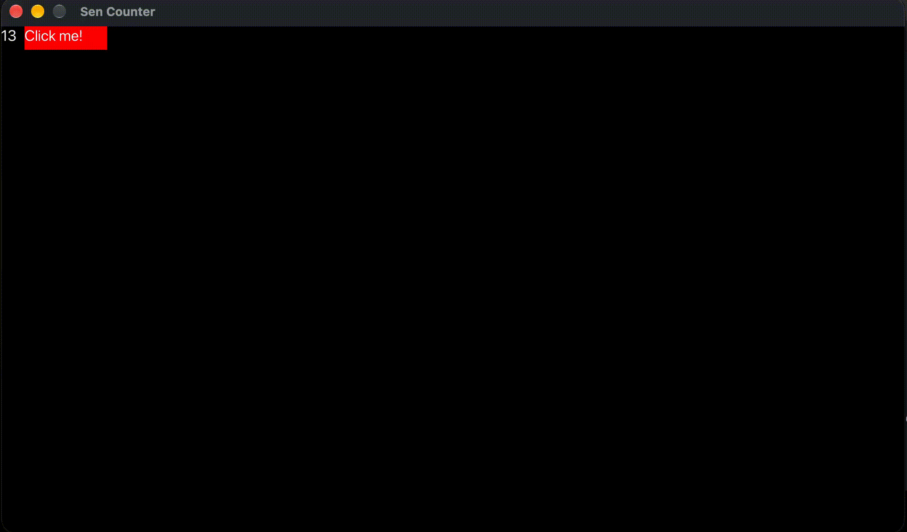

# Sen
> [!WARNING]
> This repository is no longer in active development because of
> a wait for feature sets from some dependencies.

Sen is an opinionated, declarative, type theory first library written
in Rust. Utilizing it's own custom [layout engine](https://github.com/YendisFish/flume).



### Example
An example counter program looks like the following. You can find
even more examples in ``examples/``. 

```rs
fn main() -> Result<(), Error> {
    let mut renderer = Renderer::new().unwrap();
    let window = renderer.create_window("Sen Counter", 1920, 1080);
    let mut sen = Sen::new(window, Size::take(1920., 1080.));

    sen.start(&mut renderer, App());

    Ok(())
}

#[allow(non_snake_case)]
pub fn App() -> Component {
    let st = State::new(0);
    let st_hand = st.clone();

    let font = Font::load("/System/Library/Fonts/SFNS.ttf").unwrap();
    div![
        st.with(move |val| {
            TextBox::new(val.to_string(), font.clone())
        }).size(Size::take(50., 25.)),
        Button("Click me!", move || {
            let st_val = st_hand.get().clone();
            _ = st_hand.set(st_val + 1);
        }),
    ].size(Size::take(1920., 1080.))
}

#[allow(non_snake_case)]
pub fn Button(text: impl Into<String>, on_click: impl Fn() + 'static) -> Component {
    let font = Font::load("/System/Library/Fonts/SFNS.ttf").unwrap();
    div![
        TextBox::new(text, font)
    ].on_click(on_click).color(Color::RED).size(Size::take(175., 50.))
}
```

### How to Build
You simply need cargo installed on your system to run Sen.

### Roadmap
- [ ] Await Verdant text API updates
- [ ] Implement utilize padding and margins from Flume
